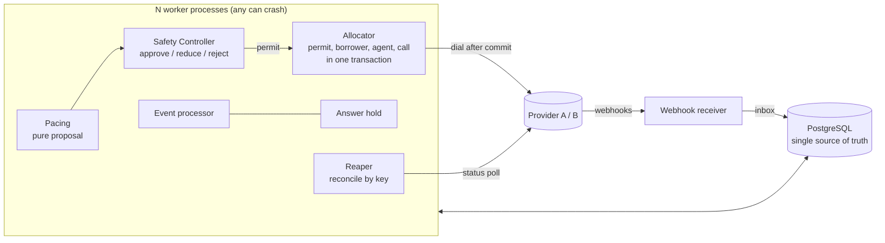

# SmartDialer

**An outbound dialer control plane for collections, coordinated only through PostgreSQL.**
Progressive and predictive dialing across many worker processes, where no call is placed unless a
Safety Controller has approved it. Built for the CredResolve take-home (`ASSIGNMENT.md`).


Start with **[docs/FINAL_ANSWER.md](docs/FINAL_ANSWER.md)** (under 300 words), then
[docs/ARCHITECTURE.md](docs/ARCHITECTURE.md).

## What it guarantees

- **No borrower is called twice at once, no agent is bound to two calls.** Every race is closed by the
  database (row locks, `SKIP LOCKED`, fencing tokens, unique keys), and each place carries a
  `# CONCURRENCY:` comment.
- **Pacing cannot dial.** It only proposes. The Safety Controller approves a number of calls as a permit, and every
  decision is logged to `safety_decisions` with its reason codes (abandon budget, overdial cap, cold start,
  answer-rate drift, agent drop, provider health, calling window).
- **Crashes lose nothing and guess nothing.** Provider events land in an inbox (deduplicated, per-call
  ordered). A worker can die at any point; another one reconciles by idempotency key with the provider.
- **Decision logic is pure** and shared by the live workers and a discrete-event simulator.

## Architecture



## Quick start

Requires Docker Desktop, running (`docker info` must succeed). All Python runs inside the `app`
container; nothing is installed on the host.

```bash
make up
```

```bash
make migrate
```

```bash
make test
```

Without `make` (Windows): `python tasks.py up`, `python tasks.py test`, `python tasks.py demo-worker-crash`.
`tasks.py` only shells out to `docker compose`.

## Failure demos

Each demo runs real processes (workers, mock provider, webhook receiver) against Postgres, then runs the
invariant checks over the history tables and prints `RESULT: PASS` or `FAIL`.

| Command | Scenario |
|---|---|
| `make demo-duplicate-events` | Same webhook delivered many times: applied once |
| `make demo-out-of-order` | Events arrive COMPLETED, ANSWERED, RINGING: ends COMPLETED, counted as an abandon, late events ignored |
| `make demo-worker-crash` | Worker SIGKILLs itself after commit before dial, and after dial before INITIATED. Another worker reconciles both by idempotency key |
| `make demo-crash-after-answered` | Worker SIGKILLs itself while applying ANSWERED, before and after COMMIT. Before: an abandon, counted. After: connected |
| `make demo-agent-drop` | 40 of 100 agents go offline within 3 s during predictive dialing: forced progressive within one tick of the threshold |
| `make demo-provider-outage` | Provider B hangs for 25 s: breaker opens, dialing stops, HALF_OPEN probes, gradual ramp back up |
| `make demo-answer-rate-shock` | Answer rate jumps 20% to 70% (and drops 70% to 10%), in the simulator |

## Other commands

| Command | What it does |
|---|---|
| `make sim` | Simulator, scenarios A to F, progressive vs predictive, Provider A vs B. Writes `docs/SIMULATION_RESULTS.md` and `docs/img/` |
| `make loadtest` | 1,000 agents, 50,000 borrowers, 8 workers, 60 s. `make loadtest ARGS="--workers 8 16 32"` for the sweep in `docs/SCALING.md` |
| `make psql` | psql into the dialer database |
| `make shell` | bash in the app container |
| `make down` | Stop and delete the database volume |

## Documentation

| Document | Contents |
|---|---|
| [FINAL_ANSWER](docs/FINAL_ANSWER.md) | The design in under 300 words |
| [ARCHITECTURE](docs/ARCHITECTURE.md) | Components, lock order, failure handling table, sequence diagrams |
| [STATE_MACHINES](docs/STATE_MACHINES.md) | Call, agent and borrower states and every allowed transition |
| [ADR](docs/ADR.md) | Decisions, the alternatives rejected, and what each one makes harder |
| [SCALING](docs/SCALING.md) | Load test at 8, 16 and 32 workers, bottlenecks, 100 to 100,000 agents |
| [SIMULATION_RESULTS](docs/SIMULATION_RESULTS.md) | Progressive vs predictive across six scenarios, with charts |
| [INTERVIEW_PREP](docs/INTERVIEW_PREP.md) | Hard questions, known weaknesses, and what is NOT BUILT |
| [PLAN](PLAN.md) | Build plan and the decision log (D1 onward) |

## Repository map

```
smartdialer/
  domain/        pure: state machines, safety rules, stats, breaker, backoff, calling window
  pacing/        pure: progressive and predictive proposals
  safety/        Safety Controller, snapshot, pacing leader lease, breaker store
  allocator/     permit -> borrower -> agent -> call in one transaction, dial after commit
  events/        webhook receiver (inbox), event processor, answer hold
  recovery/      reaper (reconciliation, leased per call), heartbeat
  worker/        the worker loop: sequences the above, no logic of its own
  transitions.py the only path that changes call or agent state
  invariants.py  checks run after every demo, test and load run
  clock.py       wall clock for the calling window, pinned by tests and demos
mock_provider/   Providers A and B with fault injection (/control)
sim/             discrete-event simulator reusing the pure modules
loadtest/        multi-process load test
demos/           one script per failure scenario
migrations/      plain SQL, applied in order
tests/
docs/
```

## Ground rules this code keeps

- PostgreSQL is the only source of truth. No cache, no queue.
- Every race is closed by the database, with a `# CONCURRENCY:` comment at each place.
- Decision logic is pure functions, shared by the workers and the simulator.
- No test or demo disables or loosens a safety rule to pass. Tests pin the clock instead of opening
  the calling window, and the mock provider never makes a borrower hang up faster than a dialer
  could bridge them unless a scenario asks for it.
