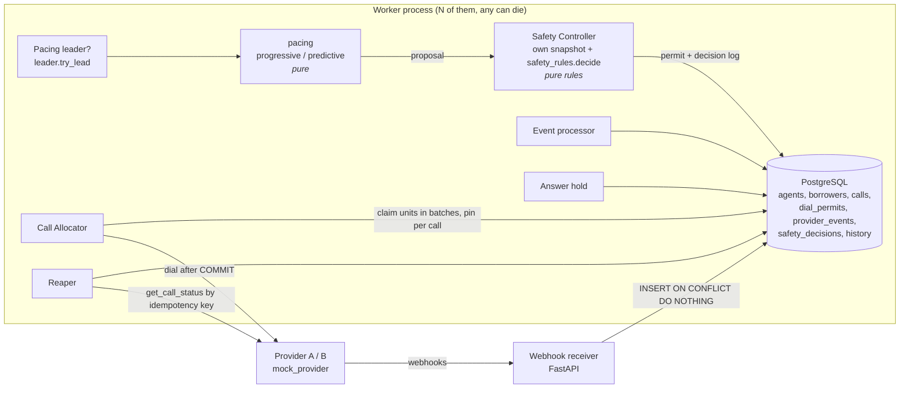

# Architecture

## One idea

PostgreSQL is the only source of truth and the only coordination mechanism. Every race
between workers is settled by one atomic statement in the database: a conditional
`UPDATE ... RETURNING`, `FOR UPDATE SKIP LOCKED`, a row lock, or a unique index. It is never
settled by memory. Decisions (state machines, pacing math, safety rules, circuit breaker) are
pure functions over a snapshot, so the same code runs in the live workers and in the simulator.

Pacing can only **propose** a number. Dialing requires consuming a unit of a `dial_permits` row,
and only the Safety Controller creates those rows.



## Components

| Component | File | Does | Never does |
|---|---|---|---|
| State machines | `domain/call_sm.py`, `domain/agent_sm.py` | Allowed-transition tables, `classify()` | I/O |
| Transitions | `transitions.py` | The single DB path for every call or agent state change, history rows, agent fencing | Decide pacing |
| Pacing | `pacing/progressive.py`, `pacing/predictive.py` | Propose a number of calls plus an explanation string | Touch the DB, dial |
| Safety Controller | `safety/controller.py`, `domain/safety_rules.py` | Revoke old permit, take its own snapshot, apply rules, log the decision, issue the permit | Trust the pacing snapshot |
| Pacing leadership | `safety/leader.py` | Campaign lease with a fencing token, bumped on takeover | |
| Breaker | `safety/breaker_store.py`, `domain/breaker.py` | CLOSED / DEGRADED / OPEN / HALF_OPEN per provider from the last 20 attempts | |
| Allocator | `allocator/allocator.py` | Claims permit units in batches (one short statement); per call: pin permit + borrower lease + agent reserve + call row in ONE transaction, then dial after commit | Dial without a permit, dial inside a transaction |
| Webhook receiver | `events/webhook_api.py` | Insert the event into the inbox, return 200 | Apply the event |
| Event processor | `events/processor.py` | Claim inbox rows, per-call FIFO, `advance_call` | |
| Answer hold | `events/answer_hold.py` | Give an answered call an agent, or abandon it after `max_answer_hold_ms` | |
| Reaper | `recovery/reaper.py` | Ask the provider about calls stuck too long, insert synthetic inbox events; release agents whose call is gone | Guess an outcome |
| Worker loop | `worker/main.py` | Sequence the above, nothing else | Contain decision logic (ADR-6) |

## Lock order

`campaign / permit -> call -> borrower -> agent`, documented in `db.py`. Every multi-row
transaction carries a `# LOCK ORDER:` comment.

- Dispatch: permit, borrower, agent, then the call row is inserted (new, nobody waits on it).
- Event processor, answer hold, reaper: call, borrower, agent.
- Agent actions (login, pause, wrap-up done): agent row only.
- Safety Controller: campaign row `FOR NO KEY UPDATE`, then the permit. It must not be
  `FOR UPDATE`: the call insert's foreign key check takes `KEY SHARE` on the campaign row while
  holding the permit, and `FOR UPDATE` blocks that. The load test found the resulting deadlock (PLAN D10).

## Permit lifecycle: claim, pin, retire

How a permit is issued, spent in batches, and retired without losing count of calls (ADR-4).

```mermaid
sequenceDiagram
    autonumber
    participant L as Pacing leader<br/>(SafetyController.decide)
    participant DB as PostgreSQL<br/>(dial_permits, calls)
    participant W as Worker<br/>(CallAllocator)

    L->>DB: INSERT permit P1 (approved N, expires now+2s, fencing token)
    W->>DB: claim_units: UPDATE P1 SET consumed_count = consumed_count + k<br/>WHERE live AND consumed_count + k <= approved (one statement)
    DB-->>W: k units (worker holds them in memory)
    loop each call, while units remain
        W->>DB: BEGIN; pin P1 FOR KEY SHARE (still live?)
        W->>DB: lease borrower (SKIP LOCKED), reserve agent, INSERT call
        W->>DB: COMMIT (pin released)
        W->>W: dial provider after commit
    end
    Note over L: next pacing tick
    L->>DB: tx 1: UPDATE P1 SET revoked = true (leader-only); COMMIT
    Note over DB,W: from here no new pin on P1 can succeed;<br/>units the worker still holds are dropped
    L->>DB: tx 2: BEGIN; lock campaign FOR NO KEY UPDATE
    L->>DB: SELECT P1 FOR UPDATE
    Note over L,DB: waits for call transactions that pinned P1 before tx 1 committed
    DB-->>L: granted once those calls committed or rolled back
    L->>DB: load snapshot (now counts every call P1 will ever produce)
    L->>DB: log decision, INSERT permit P2; COMMIT
```

## One progressive call, end to end

1. **Pacing tick (leader only).** `leader.try_lead` renews or takes the campaign lease. A
   takeover bumps `fencing_token`. `progressive.propose` returns one call per AVAILABLE agent.
   Agents already reserved are not AVAILABLE, so in-flight setups are not counted twice.
2. **Safety Controller.** Locks the campaign row, revokes the old permit, then reads its own
   snapshot. The revoke is two steps: retire the permit in its own transaction (no new pins can
   succeed), then `FOR UPDATE` it, which waits for call transactions that pinned it earlier. So the
   snapshot counts every call the old permit will produce.
   `safety_rules.decide` applies the rules. The decision row is written with its reason codes,
   and a permit row `(approved_count, expires_at = now + 2 s, fencing_token)` is inserted.
3. **Dispatch (any worker).** One transaction per call:
   before it, the worker claims up to 10 units with `claim_units` (one UPDATE that checks unrevoked,
   not expired, token current, and `consumed_count + k <= approved_count`), in its own transaction.
   Then per call: `pin` (the permit is still live, held FOR KEY SHARE)
   -> `lease_borrower` (SKIP LOCKED, due longest) -> `reserve_agent` (SKIP LOCKED, AVAILABLE ->
   RESERVED, `reserved_call_id = call id`) -> INSERT call (state RESERVED, id = fresh UUID).
   If any step finds nothing, the whole transaction rolls back and the worker keeps the unit for its
   next call. Units still held when the permit is revoked are dropped: fewer calls, never more (ADR-4).
4. **Dial, after COMMIT.** `provider.dial(idempotency_key = call id)`.
   Accepted -> call INITIATED, agent DIALING (fenced). Rejected -> FAILED(PROVIDER_ERROR),
   agent released. Uncertain (timeout) -> record nothing. After `reconcile_pre_dial_s` the reaper
   asks the provider by idempotency key.
5. **Events.** RINGING, ANSWERED and COMPLETED arrive at the webhook and go into the inbox. Any worker
   processes them in per-call order. ANSWERED moves the agent to CONNECTED, COMPLETED moves the
   agent to WRAP_UP and the borrower to DONE.
6. **Wrap-up.** The agent clicks done (`agent_action`, simulated by `demos/agent_desk.py`):
   WRAP_UP -> AVAILABLE.

## One predictive call, end to end

1. **Pacing tick.** `predictive.propose` computes a Wilson upper bound `p_hi` on the
   answer rate. It then binary-searches the largest n with
   `P(Binomial(R + n, p_hi) > C) <= 1%`, where R is calls already ringing and
   `C = available + floor(0.5 x wrap_up) - answered_waiting`. The explanation string names every term.
2. **Safety Controller.** Same as above, with the predictive rules in force: abandon budget
   (3% trip, 1.5% resume, 60 s hysteresis), agent drop, answer-rate drift, hard ratio cap
   (2.5 x available), provider health, cold start. Any of them can REDUCE, REJECT or force
   FALLBACK_TO_PROGRESSIVE.
3. **Dispatch.** As above, but no agent is reserved. The call is created QUEUED.
4. **Dial, after commit**, as above.
5. **ANSWERED** arrives. The call is ANSWERED with no agent. `answer_hold.run` claims an
   AVAILABLE agent atomically (AVAILABLE -> CONNECTED, `reserved_call_id` set) and the call goes
   CONNECTED. If no agent is free within `max_answer_hold_ms` (2 s), the call is ABANDONED and
   hung up after commit. The abandon rate feeds the next Safety Controller decision.
6. **COMPLETED**, wrap-up as above.

## Failure handling at a glance

| Failure | Mechanism | Demo |
|---|---|---|
| Duplicate webhook | UNIQUE (provider, event_id) in the inbox; `classify` -> DUPLICATE; UNIQUE (call_id, to_state) | `make demo-duplicate-events` |
| Out-of-order events | Ranks + per-call FIFO with a resequencing hold | `make demo-out-of-order` |
| Worker crash between commit and dial, or after dial before INITIATED | Reaper polls `get_call_status(call id)`. NOT_FOUND -> CANCELLED(NOT_DIALED), and the attempt is not counted; found -> real status | `make demo-worker-crash` |
| Crash after ANSWERED processed | The event is in the inbox until processed; any worker resumes | `make demo-crash-after-answered` |
| Agents drop | HARD_RATIO_CAP immediately, AGENT_DROP forces progressive | `make demo-agent-drop` |
| Provider outage | Breaker opens, decisions REJECT, HALF_OPEN probes, recovery | `make demo-provider-outage` |
| Answer-rate shock | Hard cap first, ANSWER_RATE_DRIFT forces progressive | `make demo-answer-rate-shock` |
| Two workers dial the same borrower / reserve the same agent | SKIP LOCKED + state re-check; partial unique indexes as backstop | `tests/test_races.py` (50 processes) |
| Deposed pacing leader | Fencing token checked in the permit claim and the per-call pin | `tests/test_permits.py` |
