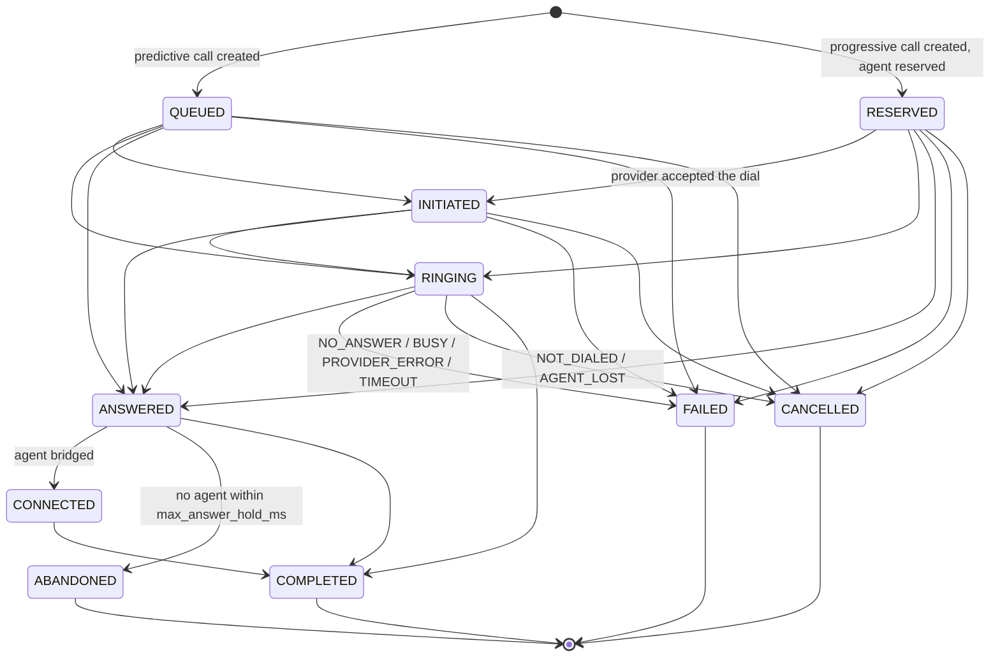
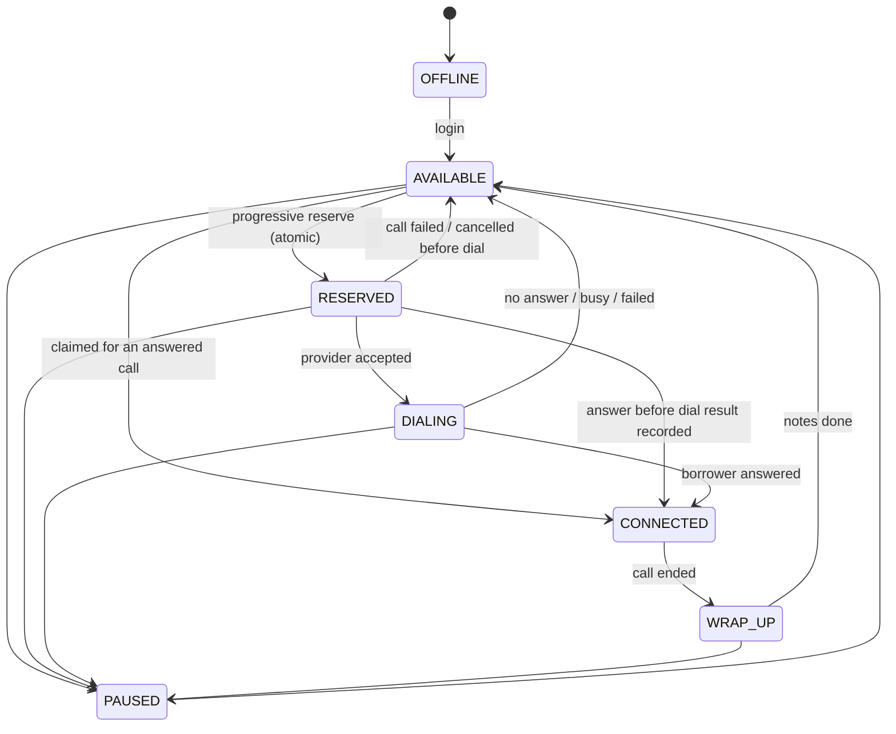

# State machines

Both machines are explicit allowed-transition tables in pure modules. Anything not in the
table is rejected. The DB writes go through one path, `smartdialer/transitions.py`, and every
change is logged to a history table (`call_transitions`, `agent_transitions`). The invariant
checks (`smartdialer/invariants.py`) replay those tables.

## Call

Source: `smartdialer/domain/call_sm.py`.

(COMPLETED is also allowed from QUEUED, RESERVED and INITIATED. They are left out of the
diagram to keep it readable.)

| From | Allowed targets | Why |
|---|---|---|
| QUEUED, RESERVED | INITIATED, RINGING, ANSWERED, COMPLETED, FAILED, CANCELLED | Events can arrive before our own dial response is recorded, and Provider B drops intermediate events, so forward moves may skip states |
| INITIATED | RINGING, ANSWERED, COMPLETED, FAILED, CANCELLED | |
| RINGING | ANSWERED, COMPLETED, FAILED, CANCELLED | |
| ANSWERED | CONNECTED, COMPLETED, ABANDONED | Never FAILED or CANCELLED after an answer: a person picked up |
| CONNECTED | COMPLETED | |
| COMPLETED, FAILED, CANCELLED, ABANDONED | none | Terminal |

Ranks: QUEUED 0, RESERVED 1, INITIATED 2, RINGING 3, ANSWERED 4, CONNECTED 5, all terminal 9.

`classify(current, target)` returns the verdict for every proposed change:

| Verdict | Condition | Effect |
|---|---|---|
| DUPLICATE | target == current | no-op (ANSWERED twice) |
| STALE_IGNORED | current is terminal, or rank(target) < rank(current) | no-op (RINGING after ANSWERED) |
| APPLY | (current, target) in the table | state changes, transition row written |
| REJECTED | moves forward but not in the table | no-op, logged (NO_ANSWER after ANSWERED) |

Ranks only increase, so a call enters each state at most once. That is why
`UNIQUE (call_id, to_state)` on `call_transitions` is a valid backstop. The insert uses
`ON CONFLICT DO NOTHING` and a conflict is treated as DUPLICATE, so the transaction does not abort.

Provider event to target state:

| Event | Target | failure_reason |
|---|---|---|
| INITIATED / RINGING / ANSWERED / COMPLETED | same name | |
| NO_ANSWER / BUSY | FAILED | NO_ANSWER / BUSY |
| FAILED | FAILED | PROVIDER_ERROR |
| NOT_FOUND (reconciliation only) | CANCELLED | NOT_DIALED |
| TIMEOUT (reconciliation only) | FAILED | TIMEOUT |

A provider sending NOT_FOUND or TIMEOUT itself is REJECTED: only the reaper may synthesize them.

## Agent

Source: `smartdialer/domain/agent_sm.py`.

Every state except OFFLINE can also go to OFFLINE (logout or agent dropped). Left out of the diagram.

| From | Allowed targets |
|---|---|
| OFFLINE | AVAILABLE |
| AVAILABLE | RESERVED, CONNECTED, PAUSED, OFFLINE |
| RESERVED | DIALING, CONNECTED, AVAILABLE, PAUSED, OFFLINE |
| DIALING | CONNECTED, AVAILABLE, PAUSED, OFFLINE |
| CONNECTED | WRAP_UP, OFFLINE |
| WRAP_UP | AVAILABLE, PAUSED, OFFLINE |
| PAUSED | AVAILABLE, OFFLINE |

## How the two machines are tied together

An agent in RESERVED, DIALING or CONNECTED is bound to exactly one call through
`agents.reserved_call_id`. The agent follows its call (`transitions._sync_agent`):

| Call state | Agent goes to |
|---|---|
| INITIATED, RINGING | DIALING |
| ANSWERED, CONNECTED | CONNECTED |
| COMPLETED | WRAP_UP if they talked, else AVAILABLE |
| FAILED, CANCELLED, ABANDONED | AVAILABLE |

Every worker-driven agent change after reservation is **fenced**: the UPDATE includes
`WHERE reserved_call_id = <this call>`. A stale worker holding an old call id changes nothing,
because call ids are UUIDs and never reused (no ABA). `tests/test_agent_fencing.py` has a stale
worker try each transition (DIALING, CONNECTED, WRAP_UP, AVAILABLE, PAUSED) and checks that none of them applies.

Human actions (login, pause, wrap-up done) go through `agent_actions.agent_action`. That path
locks only the agent row and checks the same table.
